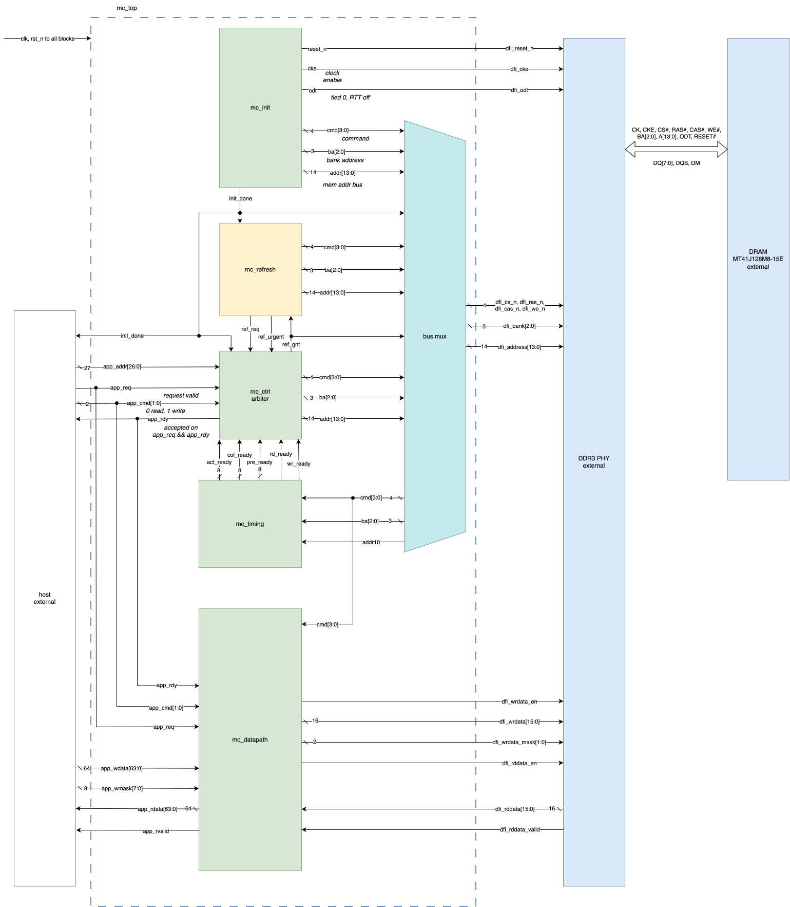

# DDR3 Memory Controller

DDR3-1333 memory controller in SystemVerilog for the Micron [MT41J128M8-15E](https://media.digikey.com/pdf/Data%20Sheets/Micron%20Technology%20Inc%20PDFs/MT41J256M4,128M8,64M16.pdf) (1 Gb, x8), with a UVM testbench that runs on Xcelium and Verilator.



## Xcelium

```sh
make regress    # all tests and seeds
make cov        # IMC coverage report
make imc        # IMC GUI
```

## Verilator

```sh
make lint
make build SIM=verilator
make sim SIM=verilator TEST=mc_page_test SEED=1
make regress SIM=verilator
make cov SIM=verilator
make sim SIM=verilator TEST=mc_refresh_test PLUSARGS=+dfi_trace=logs/trace.csv
make trace-check TRACE=logs/trace.csv
```
